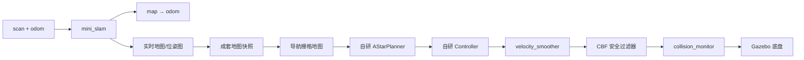

# 23 从自己建图到自己导航：当前主线课程

## 1 本课目标与先修知识

完成后你应能独立启动仿真，解释map、odom、base_link三层关系，手动建图、保存和重载地图，以mini_slam定位，并使用本项目A*及控制器导航。还要能区分导航成功、取消、失败和“看上去没有动”。

先会Linux终端、ROS话题/服务/Action即可。算法原理分别见[05接口入门](05_ROS2与Nav2接口入门.md)、[21 SLAM原理](21_SLAM建图原理零基础课.md)和[10控制器算法](10_控制器算法零基础课.md)。

本课是当前复现入口。[15](15_端到端链路实战.md)、[20](20_定位与建图SLAM.md)中的AMCL/slam_toolbox链路是对照实验，不自动等同于本课。

## 2 先建立系统图



建图时mini_slam更新位姿图；定位时冻结图，用新扫描估计当前位姿。地图由mini_slam生成，加载栅格由map_server提供给Nav2。AMCL进程可能由通用bringup启动，但当前参数关闭它的TF广播；负责map→odom的是mini_slam，不能仅凭进程存在判断定位归属。

三个容易混淆的对象：

| 对象 | 内容 | 用途 |
|---|---|---|
| .mmpg | 位姿图、节点扫描等算法状态 | mini_slam恢复定位/继续建图 |
| .yaml + .pgm | 栅格元信息和像素 | Nav2规划代价地图 |
| /mini/display_map | 随当前模式切换的显示地图 | RViz看到与当前操作对应的地图 |

只保留一张PNG不能恢复SLAM。保存服务从同一份图快照导出位姿图和栅格，防止两份文件来自不同建图时刻。

## 3 环境与编译

当前开发环境ROS 2 Jazzy、Ubuntu 24.04、WSLg。工作区路径可不同，以下默认本机布局：

```bash
cd ~/ros2_ws/src/nav2_astar_ws
source /opt/ros/jazzy/setup.bash
source ~/ros2_ws/install/setup.bash
colcon build --packages-select mini_slam nav2_astar_planner nav2_controller_lab nav2_controller_lab_rviz --cmake-args -DCMAKE_BUILD_TYPE=Release
source install/setup.bash
colcon test --packages-select mini_slam nav2_astar_planner nav2_controller_lab nav2_controller_lab_rviz
colcon test-result --verbose
```

外层source提供本机源码构建的Nav2和中间件，最后source本项目覆盖层。其他安装布局应把外层路径换成自己的实际路径，不能同时叠加不兼容的Nav2版本。用ros2 pkg prefix确认包来自期望工作区。测试条目数随版本变化，以本次输出为准。

## 4 启动与观察

```bash
./run_mini_slam_mapping.sh
```

应出现Gazebo、RViz、键盘操作终端。检查：
1. RViz RobotModel有机器人，LaserScan有点云。
2. 地图会随着扫描形成；Fixed Frame为map。
3. Controller Lab面板存在，并能选择控制器。
4. 初期没有地图/TF时的等待提示应随数据到达消失；持续错误要先排查数据。

运行脚本：[run_mini_slam_mapping.sh](../run_mini_slam_mapping.sh)。RViz配置：[mini_slam_mapping.rviz](../src/mini_slam/ros/mini_slam_mapping.rviz)。

## 5 手动建图

终端按W/S前后、A/D转向、空格停止；R/F调整线速度、T/G调整角速度。先低速走直线，再转弯，最后返回已走过的区域观察闭环。操作终端的手动速度直接发到底盘，不能当作自动避障功能。

观察地图墙线是否重复、机器人模型是否跳跃、激光是否贴合地图。小范围空旷场景也要从多个角度观察障碍，单张扫描看到的区域不能代表整张环境已建完。

本课完成条件是有可导航的已知区域，不要求每次都触发闭环。闭环发生与否应查统计，不靠看地图“变顺了”猜测。

## 6 保存、定位、重载

1. 空格停止，按3，输入地图名或完整前缀并回车。
2. 确认终端出现Saved graph and map，检查.mmpg/.yaml/.pgm。
3. 按2切到定位/导航；此时不再发送手动遥控速度。
4. 新会话按4加载已有前缀。需要时用RViz的2D Pose Estimate给出正确初始位姿。

默认地图目录为~/mini_slam_maps。已存在文件会拒绝覆盖；换一个地图名，不要把拒绝覆盖当作保存服务失效。

同一张图内从建图切定位可保留位姿先验；跨图或跨会话不能假设机器人仍在上次位置。图加载失败时终端尝试恢复原图和模式；服务结果无法确认时锁定手动输出，避免在未知状态继续运动。

操作源码：[mapping_console.py](../src/mini_slam/scripts/mapping_console.py)。算法状态切换：[mapper.cpp](../src/mini_slam/core/src/mapper.cpp)。保存接口：[mini_slam_node.hpp](../src/mini_slam/ros/mini_slam_node.hpp)。

## 7 导航与取消

在Controller Lab选择控制器，再用Nav2 Goal点击目标和拖出朝向。先在已知开阔区域选目标，再测试转弯。观察全局路径、机器人运动和终端日志，Action状态SUCCEEDED才表示导航报告成功。

按1返回手动建图。终端先取消NavigateToPose和FollowPath，等待Action结束，并以新鲜里程计确认稳定停车后再允许手动输出。Q或关闭终端结束本脚本启动的会话。

控制器选择请求不等于控制器已经成功求解；底盘速度为零也不等于无导航目标。应沿链路逐段看：cmd_vel_nav → cmd_vel_smoothed → cmd_vel_cbf → cmd_vel。

## 8 自动验收

在没有连接真实机器人的独立仿真域中：

```bash
python3 src/mini_slam/scripts/automated_session_test.py --domain 191
python3 src/mini_slam/scripts/automated_session_test.py --domain 192 --controller MPC --stationary-seconds 5 --extended-navigation
```

脚本独立启动自己的仿真、SLAM与操作终端，通过真实接口完成建图、快照、防覆盖、失败恢复、定位、导航、重载、取消和继续建图。输出目录在/tmp/mini_slam_accept_*，失败日志同样保留。

第一条默认用Pure Pursuit并观察60秒定位稳定性；第二条显式选MPC，缩短静止观察并增加长距离转向。5秒与60秒实验不能混作同一稳定性证据。候选目标从当前可达地图选取，两种控制器运行的目标未必相同，因此这些命令验证功能，不用于性能排名。

## 9 数字例子：什么叫到达

设目标(2,1)，估计位置(1.8,0.9)，则位置误差sqrt(0.2²+0.1²)=0.224m。目标角度179°、估计角度-179°，最短角差是2°，不是358°。

当前成功容差0.35m、0.25rad约14.3°。满足容差仅表示达到配置要求，不证明误差恒为35cm，更不证明厘米级精度。5cm地图分辨率也不是5cm定位精度。绝对精度要有独立、对齐且同步的真值。

## 10 常见错误

| 现象 | 先查什么 | 不应怎么处理 |
|---|---|---|
| 无机器人模型 | robot_description、模型资源、RViz状态 | 把模型缺失当作SLAM故障 |
| 雷达有点但没有地图 | mini_slam状态、scan与odom时间、TF | 先大幅修改匹配参数 |
| 地图加载失败 | 三件文件路径、前缀、服务返回 | 只复制PNG重试 |
| 目标发了没有走 | Action状态、定位、路径、速度链路 | 直接关闭CBF |
| MPC停在障碍前 | 规划和控制是否都拒绝253区域 | 放宽碰撞阈值“让它走” |
| 到目标附近不成功 | 位置/角度误差与末端切换阈值 | 只看位置忽略朝向 |
| 导航突然转圈 | 是否进入恢复、原始失败日志 | 认定全局规划器只会绕圈 |

## 11 练习与验收答案

练习A：保存地图后列出恢复定位必须的文件，并解释为什么位姿图和栅格不同。答案：.mmpg用于mini_slam，.yaml/.pgm用于栅格导航；不能互相替代。

练习B：给出一个“导航成功但绝对位置不准”的例子。答案：定位整体偏移0.2m时，控制器可在估计坐标下成功，真实底盘仍偏离目标；需独立真值揭示误差。

练习C：取消导航后立即发布手动速度是否正确？答案：不正确，Action可能尚未终止或底盘仍在滑行，需完成取消和停车确认。

必做验收：保存新地图、同图切定位、成功导航、取消中途目标、重载再导航，各保留日志或截图。失败项如实记录。完成后进入运行状态观测、实验评价和MPC故障案例课程。
