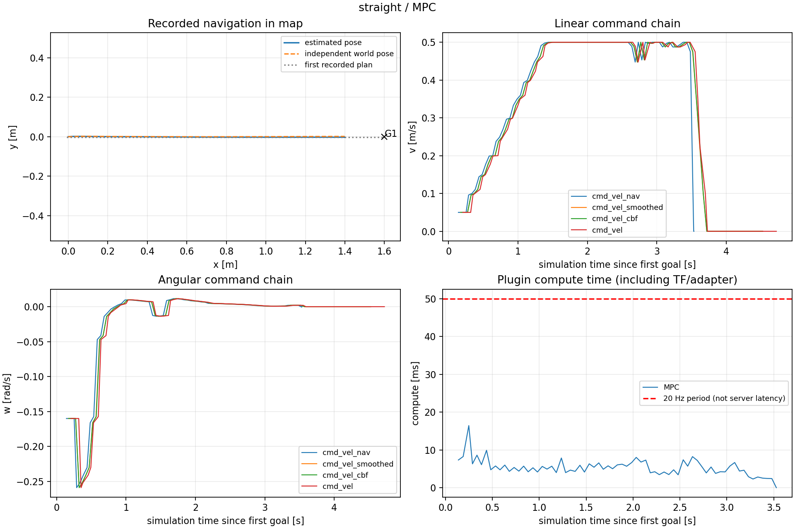

# 25 导航评价工具与公平实验

## 学习目标

能从原始数据重算报告，手算位置、角度、跟踪和速度指标，解释失败、取消、缺失真值。先读[23](23_mini_slam完整导航实践.md)与[24](24_看懂导航状态与速度链路.md)。离线计算只需Python标准库。

## 1 功能验收不是控制器排名

automated_session_test.py从当前地图选目标，每次可能不同；它验证保存、切换、导航、重载和取消功能，不适合直接排名。

公平比较要固定世界、出生位姿、地图生成流程、目标序列、控制频率、安全层、超时、构建类型和重复次数。run_navigation_lesson.py提供固定场景和目标；几何固定不代表传感器噪声及物理积分完全位级确定，仍应重复实验并报告失败。

## 2 原始事件

events.jsonl每行一个JSON对象。t统一使用仿真时钟，距离m、角度rad。不能混入Unix墙钟。compute_ms是耗时数值，不是事件时钟。

| kind | 内容 | 来源 |
|---|---|---|
| goal | goal_id、目标、坐标系、请求控制器、purpose | 实际发出的请求 |
| result | 同一goal_id及终态 | Action返回 |
| pose | map内估计位姿和TF时间 | map→base_link |
| truth | 独立位姿、坐标系、source | 可选独立真值 |
| path | 路径点、坐标系 | 实际规划输出 |
| prediction | 模型预测点、计算时间、变换来源 | MPC实际选中序列，仅供观测 |
| command | topic、v/w | 各段速度及接收时刻 |
| diagnostic | 实际控制器、阶段、compute_ms | 插件诊断 |

prediction是控制器模型输出，不能代替truth；显示/采集使用最新TF转换时保留transform_source和原始坐标来源，避免把它误当严格时间同步轨迹。

同一目标不能重复写终态；未知结果保持unknown，不能伪造ABORTED。输入NaN/inf会被拒绝，不悄悄当成正常样本。

## 3 采集与重算

```bash
python3 src/mini_slam/scripts/automated_session_test.py --domain 201 --controller MPC --stationary-seconds 5
python3 docs/tools/run_navigation_lesson.py --scenario straight --controller MPC --domain 203
```

把下列输入替换成真实输出目录。报告目录必须不存在：

```bash
python3 docs/tools/navigation_metrics.py /tmp/你的实验目录/events.jsonl --output /tmp/你的新报告目录
python3 docs/tools/tests/test_navigation_metrics.py
```

report.json保留口径、参数、每目标指标和汇总；runs.csv便于表格分析。原始文件不变，已有报告拒绝覆盖。

## 4 数字例子

### 位置和角度

目标(1,0)，估计(0.8,0)，位置误差0.2m。179°与-179°的最短角差是2°，不是358°。公式为atan2(sin差值,cos差值)。

estimated表示定位坐标下误差；true表示独立真值到目标的误差。估计很准而真实不准时，先检查定位，而非只调控制器。

### RMSE

三个误差0、0.1、0.2m，RMSE=sqrt(0.05/3)=0.1291m；平均误差0.1m。还应报告P95、最大值、样本数和未匹配数量。三个样本的P95不能替代多次独立实验。

### 横向跟踪

路径是(0,0)到(1,0)，机器人(0.5,0.2)，折线最近点为(0.5,0)，误差0.2m。只找最近顶点会夸大误差。

工具使用本目标期间收到的最新规划路径。重规划会改变参考，因此该指标不是对某条固定历史路径的偏差。

### 指令变化

v=0、0.2、0.3，总变化TV=0.3m/s。间隔0.5s时差分加速度为0.4、0.2m/s²。一直停车也有很小的TV，必须联合成功率、耗时、行程解读。指令加速度不等于IMU实测加速度。

## 5 成功、取消、失败口径

所有目标的成功比例、普通reach_goal的成功率、专门cancel_test的取消完成数分别统计。两次到点成功加一次按设计取消，全部目标SUCCEEDED比例是2/3，到点任务成功率是2/2，取消测试完成1次。

不要把按设计取消讲成导航算法失败，也不要把真的失败隐藏在“换个目标重试”之后。封路场景PASS可表示“正确拒绝不可行任务”，不是机器人到达了目标。

## 6 时间与坐标

真值用最近时间匹配，默认最大差0.1s，不做隐含插值。1m/s机器人错开0.1s可产生0.1m误差。应检查采样率、时差分布，逐步收紧窗口，不为增加样本而任意放宽。

坐标变换：
x_map=tx+cos(theta)x_world-sin(theta)y_world；
y_map=ty+sin(theta)x_world+cos(theta)y_world；
yaw_map=yaw_world+theta。

固定变换必须注明来源，不能每帧用估计重新拟合，抵消真实漂移。不同truth坐标系不能混用一个变换。没有真值时定位RMSE为null，不是0；没有新鲜终态位姿时末端误差也为null。

## 7 为什么成功后的采样误差可能超过容差

stateful goal checker可能先满足位置再转向；Action结果、TF样本和位置判定不完全同时。工具使用终态前最近且不过期的位姿，未必就是goal checker当时用的数据。

因此保留“SUCCEEDED但末端样本误差较大”的记录，核对时间、状态式检查和定位变化。成功容差不是末端真实误差上界证明。

## 8 必须填写的报告信息

代码版本及工作区是否有未提交修改、世界和参数哈希、出生位姿、目标序列、控制器、安全层、位置/角度容差、仿真时段、重复次数、结果分类、指标样本数、真值和对齐来源、失败日志路径。

插件compute_ms不含服务器外部等待。墙钟运行时间、仿真任务时间和开发用时也不是同一种时间。不要只报最快一次或均值。

## 9 练习答案

A. 删除truth再算：预期精度未知，而非0。
B. truth延迟1秒：匹配数减少，不能继续沿用旧精度结论。
C. 重复result：应拒绝输入，避免重复计数。
D. 有效取消：分类为canceled且标记cancel_test，不伪装成功。
E. 只有一条pose：不能据此声称行程为0，应显示行程未知。

源码navigation_metrics.py，已知答案测试在tools/tests；采样入口在automated_session_test.py的sample_pose、command_cb、control_diagnostics_cb和start_navigation。

## 10 可直接重算的课堂样本与图表

[真实样本](results/lesson_runs/README.md)包含压缩原始数据、原报告和实验配置，可在不启动ROS的情况下重算。--configuration复用原报告的对齐与匹配口径，避免默认口径不同导致比较无效。



图只展示该样本，不能从一次成功画面推出稳定性能。蓝色估计与橙色真值分开，50ms虚线只是20Hz周期参考，不是实测服务器延迟。
