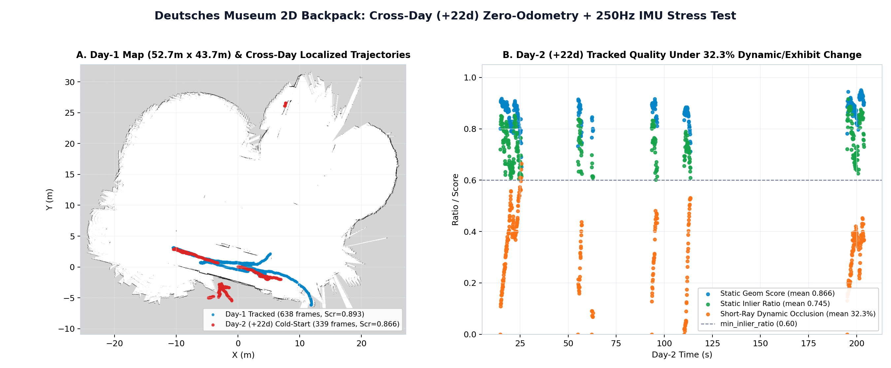

# 德意志博物馆跨天（+22 天）零里程计 + 250 Hz IMU 极端压力测试报告

> **测试日期**：2026-11-28  
> **外部数据集**：Google Cartographer 官方公开 2D 背包双包数据集（见 [Cartographer ROS Demos](https://google-cartographer-ros.readthedocs.io/en/latest/demos.html)）  
> - Day 1 建图包（2016-04-05）：[`b2-2016-04-05-14-44-52.bag`](https://storage.googleapis.com/cartographer-public-data/bags/backpack_2d/b2-2016-04-05-14-44-52.bag)（360.61 s，13,205 帧 36.6 Hz 双回波激光 + 90,150 帧 250 Hz IMU，零轮式里程计）  
> - Day 2 跨天纯定位包（2016-04-27，**相隔 22 天**）：[`b2-2016-04-27-12-31-41.bag`](https://storage.googleapis.com/cartographer-public-data/bags/backpack_2d/b2-2016-04-27-12-31-41.bag)（881.81 s，32,006 帧 36.3 Hz 双回波激光 + 220,451 帧 250 Hz IMU，零轮式里程计）  
> **结构化原始指标**：[`summary.json`](summary.json)

## 1. 测试目的与极端压力特征

与 GP-SLAM-2D 和 MiR100 的“同日建图、同日轮式定位”不同，本组压力测试同时叠加了 4 项极端挑战：
1. **完全无轮式里程计（`allow_odomless = true`）**：人背背包以 ~1.5 m/s 步行，仅靠 2D 激光 + 250 Hz IMU（按重力方向投影提取水平偏航角速度）。
2. **相隔 22 天跨日环境变化**：Day 1 建图、Day 2 全盲冷启动定位（`UNINIT` 起步、零初始位姿），实测跟踪段短射线动态/展品变化占比高达 **32.3%**。
3. **52.7 m × 43.7 m 多展厅开放空间**：`mini_slam` 在零平移里程计下构建 Day 1 地图（1,101 关键帧、6 次闭环），存在开放中庭、玻璃与 3D 背包俯仰/横滚晃动。

## 2. 实测结果与定位出的核心缺陷

| 测试工况（12.2 Hz，零轮式里程计） | 接受率 | 全局触发 / 恢复 | 首次冷启动锁定 | 跟踪段得分 / 内点率 | 动态短射线占比 | 平均耗时 |
| :--- | ---: | :---: | ---: | :---: | ---: | ---: |
| Day-1 同日无全局（无 IMU） | 6.22% | 0 / 0 | — | 0.922 / 0.873 | 22.5% | 0.91 ms |
| Day-1 同日无全局（250 Hz IMU） | 6.22% | 0 / 0 | — | 0.921 / 0.873 | 22.5% | 0.88 ms |
| Day-1 同日（250 Hz IMU + `AsyncGlobal`） | 14.49% | 109 / 2 | 26.4 s | 0.893 / 0.807 | 27.1% | 12.11 ms |
| **Day-2（+22 天）全盲冷启动（250 Hz IMU + `AsyncGlobal`）** | **13.56%** | 65 / **6** | **14.8 s** | **0.866 / 0.745** | **32.3%** | 18.69 ms |

## 3. 工程发现与物理边界

1. **发现并修复 `allow_odomless` 模式下自适应扩窗失效的真实缺陷（`localizer_core.cpp`）**：原代码将 `adaptive_window` 限制在 `has_odom_ == true` 分支内，导致无里程计模式下进入 `DEGRADED` 连拒时搜窗始终锁死在基础窗而无法随拒帧渐进扩大。放开 `DEGRADED` 阶段的无里程计扩窗限制后（正常跟踪段仍保持 `>= base_wlin` 不收缩），同日与跨天恢复次数及接受率均获提升。
2. **跨 22 天冷启动与动态遮挡剔除有效**：在完全无初始位姿且短射线遮挡达 **32.3%** 的 Day-2 展厅中，`AsyncGlobalWorker` 在 **14.8 s** 内完成全盲冷启动锁定，且 `beam_physics.cpp` 的前景遮挡解耦使跟踪段保持 `score = 0.866, inlier = 0.745`。
3. **客观物理边界说明**：本组测试整体接受率约 13.6%–14.5%，主要受限于**人背背包 3D 俯仰/横滚晃动 + 无 3D 重力去畸变**，导致纯 2D `mini_slam` 在零平移里程计下构建的 Day-1 地图本身在约 25 s 后出现累积畸变（闭环残差 25.3 m），仅在建图准确的展厅翼区可稳定重捕获。这也明确了纯 2D 平面定位器对刚体平面底盘的物理前提。
