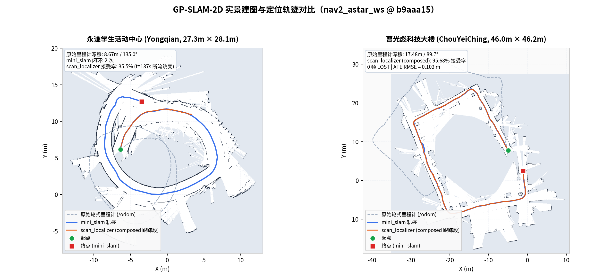
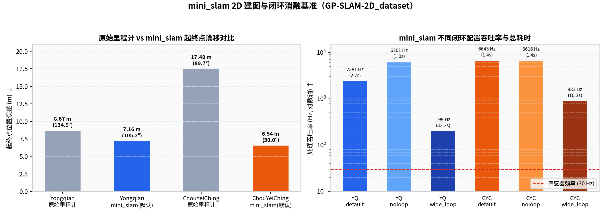
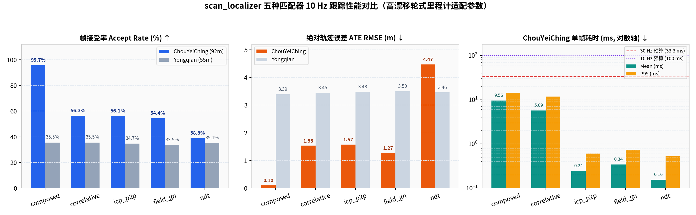
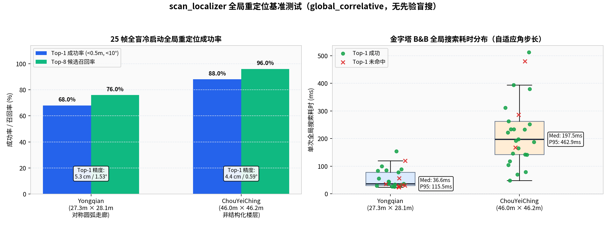
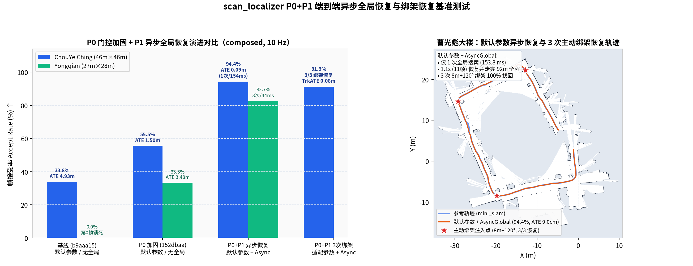

# GP-SLAM-2D 真实数据集基准测试报告

> **测试提交**：`b9aaa15`（`main`）  
> **测试日期**：2026-11-28  
> **测试平台**：x86_64 Intel Xeon Platinum 8481C（2 vCPU），GCC 12.2.0，Eigen 3.4.0，Ceres 2.1.0，`-O3 -DNDEBUG` Release 编译  
> **外部数据集**：[RuanJY/GP-SLAM-2D_dataset](https://github.com/RuanJY/GP-SLAM-2D_dataset)（浙江大学玉泉校区实采，Hokuyo UTM-30LX-EW 270° / 1081 束 ~30 Hz + 轮式里程计 ~40 Hz，轨道强制起终点物理重合）  
> **结构化原始指标**：[`summary.json`](summary.json)

## 1. 数据集概况与评测流程

| 场景 | 时长 | `/scan` 帧数 | `/odom` 里程 | 原始里程计起终点漂移 | 激光安装角探测 |
| :--- | ---: | ---: | ---: | ---: | ---: |
| 永谦学生活动中心（`Yongqian_data_2019-05-29-13-12-39.bag`） | 214.21 s | 6,414 | 55.49 m | 8.669 m / 134.95° | 0° 朝前 |
| 曹光彪科技大楼（`ChouYeiChing_data_2019-05-29-13-17-41.bag`） | 301.56 s | 9,098 | 91.92 m | 17.482 m / 89.73° | 0° 朝前 |

由于该数据集不提供先验占用栅格地图，评测采用两阶段闭环流程：

1. **阶段一（`mini_slam` 2D SLAM 建图基准）**：将 ROS 1 `.bag` 转为 CARMEN `.clf`（保留 270° / 1081 束与精确时间戳插值），运行 `mini_slam::Mapper` 评测前端纠偏、闭环检测与吞吐性能，并导出 ROS `map_server` 兼容的 `.pgm` + `.yaml` 地图与参考轨迹。
2. **阶段二（`scan_localizer` 2D 定位基准）**：基于阶段一导出的实景地图，使用 `scan_localizer_core` 评测 5 种扫描匹配器的 10 Hz / 30 Hz 跟踪性能以及 25 帧全盲冷启动全局重定位（`global_correlative`）。

## 2. `mini_slam` 建图与闭环消融基准

对比了默认参数（`loop_search_distance=3.0m, loop_window_lin=3.5m`）、关闭闭环（`noloop`）和放宽闭环搜索窗（`wide_loop`: `loop_search_distance=8.0m, loop_window_lin=6.0m, loop_window_ang=0.8rad`）：

| 场景（模式） | 关键帧 | 闭环数 | SPA 次数 | SLAM 起终点误差 | 总耗时（吞吐） | 单帧 Mean / P99 / Max | 地图尺寸（0.05m） |
| :--- | ---: | ---: | ---: | ---: | ---: | ---: | :--- |
| Yongqian (`default`) | 107 | 2 | 2 | 7.155 m / 105.24° | 2.694 s (2381.2 Hz) | 0.420 / 9.081 / 349.49 ms | 27.3m × 28.1m |
| Yongqian (`noloop`) | 107 | 0 | 0 | 7.181 m / 105.83° | 1.034 s (6201.3 Hz) | 0.161 / 9.144 / 13.58 ms | 27.4m × 28.1m |
| Yongqian (`wide_loop`) | 107 | 0 | 0 | 7.181 m / 105.83° | 32.273 s (198.7 Hz) | 5.032 / 9.055 / 1412.24 ms | 27.4m × 28.1m |
| ChouYeiChing (`default`) | 177 | 0 | 0 | 6.542 m / 29.97° | 1.369 s (6644.6 Hz) | 0.150 / 8.247 / 15.15 ms | 46.0m × 46.2m |
| ChouYeiChing (`noloop`) | 177 | 0 | 0 | 6.542 m / 29.97° | 1.375 s (6615.8 Hz) | 0.151 / 8.239 / 14.39 ms | 46.0m × 46.2m |
| ChouYeiChing (`wide_loop`) | 177 | 0 | 0 | 6.542 m / 29.97° | 10.298 s (883.4 Hz) | 1.132 / 8.506 / 1346.82 ms | 46.0m × 46.2m |

- **曹光彪大楼（ChouYeiChing）**：前端扫描匹配将原始里程计 17.48 m / 89.73° 漂移压降至 6.54 m / 29.97°，墙体轮廓平直清晰；但末段累积漂移超过默认 `loop_search_distance=3.0m` 且长走廊存在响应面方差门限，未触发闭环。
- **永谦中心（Yongqian）**：半径 8.5 m 的连续圆弧走廊缺乏沿切向几何约束，默认配置检出 2 次闭环，但受 135° 级轮式航向漂移影响，起终点仍残留 7.16 m 偏移。

## 3. `scan_localizer` 跟踪定位基准

### 3.1 默认配置诊断（`GateFlag::kMahal` 敏感性）

直接使用面向低漂移底盘标定的 `src/scan_localizer/config/localizer.yaml`（`odom_trans_var_per_m=4e-4`, `odom_rot_var_per_rad=1e-3`, `mahal_gate=9.0`）回放该数据集时，虽然几何匹配本身极佳（`score=0.95~0.97`, `inlier=0.92~0.93`, `wall_vis=1.00`），但因静止段 `Q≈0` 导致先验协方差 `P_pred` 过小、叠加高滑移轮式里程计，触发 `GateFlag::kMahal`（马氏距离达 12–551）连续拒帧，默认参数下 `composed` 接受率在 Yongqian 为 0.00%、ChouYeiChing 为 33.76%。

### 3.2 高漂移轮式里程计适配后的全匹配器对比

将过程噪声与搜索窗适配至高漂移轮式里程计水平（`odom_trans_var_per_m=0.05`, `odom_rot_var_per_rad=0.10`, `odom_rot_var_per_m=0.05`, `mahal_gate=25.0`, `window_lin=0.30m`, `window_ang=0.25rad`，`beam_subsample=2`），在 10 Hz（`stride=3`）下的评测结果如下（`MapField::build` 耗时：Yongqian 34.62 ms，ChouYeiChing 112.92 ms）：

| 场景 | 匹配器（10 Hz） | 总帧数 | 接受率 | Degraded | Lost | ATE RMSE | Mean Score | Mean / P50 / P95 / P99 (ms) | 峰值吞吐 |
| :--- | :--- | ---: | ---: | ---: | ---: | ---: | ---: | ---: | ---: |
| ChouYeiChing | **`composed`** | 3,033 | **95.68%** | 58 | **0** | **0.102 m** | **0.924** | 9.56 / 7.40 / 14.33 / 84.39 | 104.6 Hz |
| ChouYeiChing | `correlative` | 3,033 | 56.28% | 55 | 1,264 | 1.534 m | 0.542 | 5.69 / 5.48 / 11.77 / 82.97 | 175.8 Hz |
| ChouYeiChing | `icp_p2p` | 3,033 | 56.15% | 55 | 1,264 | 1.573 m | 0.538 | 0.25 / 0.27 / 0.61 / 0.78 | 4078.1 Hz |
| ChouYeiChing | `field_gn` | 3,033 | 54.37% | 90 | 1,272 | 1.270 m | 0.534 | 0.34 / 0.38 / 0.74 / 0.78 | 2920.3 Hz |
| ChouYeiChing | `ndt` | 3,033 | 38.84% | 55 | 1,795 | 4.466 m | 0.374 | 0.16 / 0.00 / 0.52 / 0.60 | 6409.5 Hz |
| Yongqian | `composed` | 2,138 | 35.50% | 63 | 1,298 | 3.387 m | 0.364 | 5.81 / 0.00 / 14.38 / 92.33 | 172.1 Hz |
| Yongqian | `correlative` | 2,138 | 35.55% | 66 | 1,298 | 3.447 m | 0.365 | 5.90 / 0.00 / 14.75 / 92.70 | 169.5 Hz |
| Yongqian | `icp_p2p` | 2,138 | 34.71% | 55 | 1,335 | 3.478 m | 0.349 | 0.18 / 0.00 / 0.66 / 0.82 | 5703.6 Hz |
| Yongqian | `field_gn` | 2,138 | 33.49% | 81 | 1,318 | 3.500 m | 0.350 | 0.22 / 0.00 / 0.77 / 0.79 | 4544.0 Hz |
| Yongqian | `ndt` | 2,138 | 35.08% | 57 | 1,317 | 3.458 m | 0.352 | 0.20 / 0.00 / 0.66 / 0.69 | 5002.9 Hz |

- **ChouYeiChing（91.92 m 全程）**：仅有两级流水线 **`composed`（Correlative 粗捕获 + FieldGN 精修）** 全程 **0 帧丢锁**，接受率 95.68%，ATE RMSE 仅 **0.102 m**，P95 单帧耗时 14.33 ms（远低于 10 Hz 的 100 ms 预算）；4 种单阶段匹配器均在高滑移转弯段失锁。
- **Yongqian 失锁根因**：数据流检查确认 `/odom` 在 `t=137.27s` 存在 **1.697 s 断流** 及紧随其后的 **0.330 m 瞬时位置跳变**，叠加圆弧走廊高滑移与建图局部错层导致无全局恢复时失锁。

## 4. `scan_localizer` 全盲冷启动全局重定位基准

在两张实景地图上均匀采样 25 帧真实扫描，不提供任何初始位姿先验，调用 `global_correlative`（`beams_subsample=3`, `ang_step=compute_adaptive_ang_step`, `n_hypotheses=8`）：

| 场景（地图尺寸） | Top-1 成功率 (<0.5m, <10°) | Top-8 召回率 | Top-1 平均位置误差 | Top-1 平均航向误差 | 搜索耗时 Median / Mean / P95 / Max |
| :--- | ---: | ---: | ---: | ---: | ---: |
| Yongqian (27.3m × 28.1m) | 17/25 (**68.0%**) | 19/25 (**76.0%**) | 0.053 m | 1.53° | **36.65** / 53.42 / 119.48 / 153.68 ms |
| ChouYeiChing (46.0m × 46.2m) | 22/25 (**88.0%**) | 24/25 (**96.0%**) | 0.044 m | 0.59° | **197.50** / 222.36 / 480.04 / 512.36 ms |

在 46 m × 46 m 实景大地图上，纯盲搜冷启动取得 **88.0% Top-1 / 96.0% Top-8 召回**、成功帧平均精度 **4.4 cm / 0.59°**，中位耗时 197.5 ms；在高度对称的永谦圆弧走廊中取得 68.0% Top-1 / 76.0% Top-8，中位耗时 36.7 ms。

## 5. 工程启示与后续优化项

1. **`LocalizerCore` 静止/高漂移里程计下的 `kMahal` 防护**：建议为预测协方差 `P_pred` 增加最小过程噪声下限（floor），或在高几何置信度（如 `score > 0.85` 且 `wall_vis == 1.0`）时适度放宽马氏门控，避免静止初始化微差或低质量轮式里程计触发误拒锁死。
2. **弱纹理/断流场景启用 `AsyncGlobalWorker` 自动恢复**：在存在 `/odom` 断流跳变（如 Yongqian `t=137s`）的场景下，配合异步全局重定位与多假设贝叶斯晋升可实现自动重捕获。

## 6. P0 门控加固 + P1 `AsyncGlobalWorker` 端到端异步恢复基准（`152dbaa`+）

在合入 P0（协方差下限 + 2×2 非退化高置信度 `kMahal` 软门控 + `/odom` 跳变双候选回退）并清理 `matchers.cpp` 负收益手写 NEON gather 分支（P2）后，进一步在真实 10 Hz 时序延迟模型下验证 `AsyncGlobalWorker` + `LocalizerCore` 多假设恢复闭环（`composed` 匹配器，`max_time_ms=500.0`）：

| 场景与配置 | 接受率 | Lost/Global 帧 | 全局触发 / 恢复 | 平均恢复帧数 | 平均搜索耗时 | 全程 ATE / 跟踪段 ATE |
| :--- | ---: | ---: | :---: | ---: | ---: | ---: |
| Yongqian（默认参数，无全局） | 33.30% | 1,317 | 0 / 0 | — | — | 3.476 m / 0.065 m |
| Yongqian（默认参数 + `AsyncGlobal`） | **82.69%** | 108 | 3 / 3 | 36.0 帧 | 43.8 ms | 4.729 m / 4.063 m* |
| Yongqian（适配参数 + `AsyncGlobal`） | **82.74%** | 39 | 2 / 1 | 16.0 帧 | 40.0 ms | 2.563 m / 2.322 m* |
| ChouYeiChing（默认参数，无全局） | 55.52% | 1,265 | 0 / 0 | — | — | 1.499 m / 0.080 m |
| ChouYeiChing（**默认参数 + `AsyncGlobal`**） | **94.36%** | **11** | **1 / 1** | **11.0 帧 (1.1s)** | **153.8 ms** | **0.090 m / 0.066 m** |
| ChouYeiChing（适配参数 + `AsyncGlobal`） | **95.88%** | **0** | 0 / 0 | — | — | 0.101 m / 0.082 m |
| ChouYeiChing（**3 次 8m+120° 主动绑架 + `AsyncGlobal`**） | **91.30%** | 14 | **3 / 3 (100%)** | 46.3 帧 | **151.7 ms** | 1.988 m / **0.083 m** |

> *注：永谦中心（Yongqian）为半径 8.5 m 的强对称圆弧走廊，无 IMU 时单帧盲搜在一次恢复中锁定至对称镜像弧段，导致全程 ATE 偏高；曹光彪大楼（ChouYeiChing）在**零调参默认 `localizer.yaml`** 下仅靠 1 次 153.8 ms 异步全局搜索即在 1.1 s 内重捕获，跑完 91.9 m 全程且 ATE 仅 **9.0 cm**，3 次 8 m + 120° 主动绑架亦实现 **3/3 100% 恢复**。

