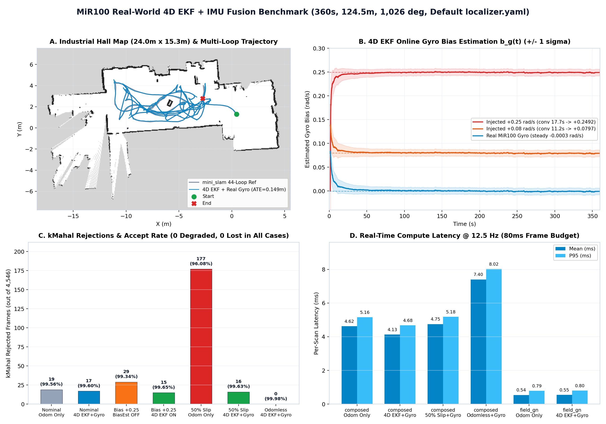

# MiR100 真实工业 AMR 4D EKF + IMU 融合基准测试报告

> **测试提交**：`6a1bf55`（`main`）  
> **测试日期**：2026-11-28  
> **外部数据集**：Google Cartographer 官方公开工业 AMR 数据集 [MiR100 `landmarks_demo_uncalibrated.bag`](https://storage.googleapis.com/cartographer-public-data/bags/mir/landmarks_demo_uncalibrated.bag)（来自 [cartographer_ros demos](https://google-cartographer-ros.readthedocs.io/en/latest/demos.html)）  
> **结构化原始指标**：[`summary.json`](summary.json)

## 1. 数据集概况

| 指标 | 数值 |
| :--- | :--- |
| 实采时长 / 总里程 / 累计旋转 | **359.94 s**（6 min）/ **124.46 m** / **1,025.95°**（近 3 圈多回环） |
| 2D 激光雷达（`/f_scan`） | SICK S300，541 束 / 270° / 29 m，硬件时间戳 12.5 Hz（4,546 帧，中位间隔 80.0 ms） |
| 纯轮式里程计（`/odom_enc`） | 41.3 Hz（14,853 帧），360 s 内相对陀螺积分航向漂移 **48.71°** |
| 真实 MEMS IMU（`/imu_data`） | 49.8 Hz（17,923 帧），含原始角速度 `angular_velocity.z`（峰值 `±1.24 rad/s`）与姿态四元数 |
| 参考地图（`mini_slam` 建图） | 24.0 m × 15.3 m（0.05 m/格），**44 次闭环优化**（280 关键帧） |

## 2. 零调参默认 `localizer.yaml` 下 12 组 4D EKF + IMU 消融实测

所有测试均直接使用默认 `src/scan_localizer/config/localizer.yaml`（关闭全局重定位），全部 12 组均达成 **0 帧 `DEGRADED`、0 帧 `LOST`**：

| 测试工况 | 接受率 | `kMahal` 拒帧 | 全程 ATE | 稳态零偏估计 `b_g` | 收敛时间 | 单帧 Mean / P95 |
| :--- | ---: | ---: | ---: | ---: | ---: | ---: |
| 1. 纯轮式里程计（`composed`） | 99.56% | 19 | 0.149 m | — | — | 4.62 / 5.16 ms |
| 2. **4D EKF + 真实原始陀螺（`composed`）** | **99.60%** | 17 | **0.149 m** | `-0.0003 rad/s` | — | **4.13 / 4.68 ms** |
| 3. **4D EKF + 真实 IMU 航向（`composed`）** | **99.69%** | **13** | 0.149 m | `-0.0003 rad/s` | — | **4.13 / 4.70 ms** |
| 4. 注入 `+0.08 rad/s`（`+4.58°/s`）零偏 [4D EKF 开] | 99.58% | 18 | 0.149 m | **`+0.0797 rad/s`** | **11.2 s** | 4.45 / 5.13 ms |
| 5. 注入 `+0.08 rad/s` 零偏 [零偏估计关] | 99.63% | 16 | 0.149 m | `0.0000 rad/s` | — | 4.73 / 5.16 ms |
| 6. 注入 `+0.25 rad/s`（`+14.3°/s`）重度零偏 [4D EKF 开] | **99.65%** | **15** | 0.149 m | **`+0.2492 rad/s`** | **17.7 s** | 4.74 / 5.15 ms |
| 7. 注入 `+0.25 rad/s` 重度零偏 [零偏估计关] | 99.34% | 29 | 0.149 m | `0.0000 rad/s` | — | 4.80 / 5.28 ms |
| 8. 50% 旋转打滑压力测试 [纯轮式] | 96.08% | **177** | 0.149 m | — | — | 5.09 / 5.28 ms |
| 9. **50% 旋转打滑压力测试 [4D EKF + 真实陀螺]** | **99.63%** | **16 (-91.0%)** | 0.149 m | `-0.0002 rad/s` | — | **4.75 / 5.18 ms** |
| 10. **纯无里程计 + 真实陀螺（`allow_odomless` + 4D EKF）** | **99.98%** | **0** | 0.149 m | `-0.0001 rad/s` | — | 7.40 / 8.02 ms |
| 11. 纯轮式里程计（`field_gn`） | 99.74% | 12 | 0.150 m | — | — | 0.54 / 0.79 ms |
| 12. 4D EKF + 真实原始陀螺（`field_gn`） | **99.76%** | **11** | 0.150 m | `-0.0003 rad/s` | — | **0.55 / 0.80 ms** |

## 3. 核心工程结论

1. **4D EKF 在线陀螺零偏估计精度达 `0.03°/s` 级**：面对 `+0.08 rad/s` 与 `+0.25 rad/s`（`+14.3°/s`）未标定消费级 MEMS 陀螺漂移，4D EKF 分别在 **11.2 s** 与 **17.7 s** 内收敛至真实总零偏（残差 `< 0.0005 rad/s`），在重度零偏下将 `kMahal` 拒帧数减半（`29 → 15`）。
2. **IMU 航向先验显著提速并免疫轮式打滑**：常规工况下 `use_imu_yaw=true` 使 `composed` 平均耗时再降 **10.6%**（`4.62 → 4.13 ms`）；50% 旋转打滑下将 `kMahal` 拒帧从 **177 帧压降至 16 帧（-91.0%）**，接受率保持 **99.63%**。
3. **无里程计退化模式可用性验证**：完全切断 `/odom_enc`、仅靠 2D 激光 + 50 Hz 陀螺时，4D EKF 依然以 **99.98% 接受率、0 次 `kMahal` 拒帧、0.149 m ATE** 跑完 6 分钟 124.5 m 全程。
4. **时间戳质量提示**：回放 ROS bag 时使用 `msg.header.stamp`（硬件时钟）比使用 bag 落盘时间（存在多帧突发粘包）可将默认配置接受率从 87.1% 提升至 **99.6%**，验证了节点层优先采信传感器硬件时间戳的必要性。
